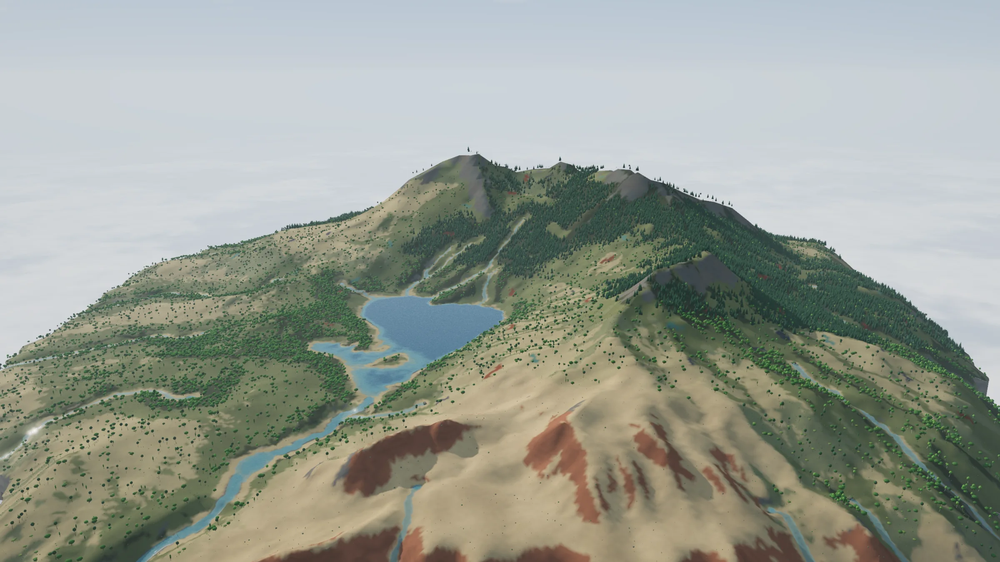

<h1 align="center">Dawnfolk</h1>

<p align="center">A god game about the first tribes on a floating island.</p>

<p align="center">
  <a
    href="https://github.com/svidskiy/dawnfolk/actions/workflows/ci.yml"
  ></a>
  <a
    href="LICENSE"
  ></a>
  
</p>

<p align="center">
  <a href="https://dawnfolk.svidskiy.workers.dev">Play</a> ·
  <a href="#features">Features</a> ·
  <a href="#getting-started">Getting started</a> ·
  <a href="#architecture">Architecture</a> ·
  <a href="CONTRIBUTING.md">Contributing</a>
</p>



Shape the land, call rain, fire and lightning, and watch small tribes gather, build, learn and survive on a
procedurally generated island rendered with WebGPU.

## Features

- **A living island.** Every world is generated from a seed: relief, erosion, rivers, lakes, waterfalls off the
  edge, climate, biomes and forests. Seasons change foliage, snow settles and melts, fire spreads with the wind.
- **Tribes with their own lives.** People gather, hunt, fish, farm, chop, quarry, build camps and huts, warm
  themselves at campfires, pray, learn technologies, migrate and split into new tribes. Herds of deer, mammoths and
  ibex graze and flee, ibex up the nearest heights, and wolf packs roam far from people.
- **Powers with real parameters.** Elements, land and life powers (fire, lightning, rain, snow, explosions,
  meteors, earthquakes, raising and painting land, forests, healing, new tribes and more). Every power is described
  by a schema, so its strength, radius and other settings appear as controls automatically. World rules (how fast
  fire spreads, how far embers fly, how hungry people get) are adjustable in the settings.
- **A model engine.** People, animals, trees, rocks and buildings are built procedurally from seeds: varied bodies,
  clothes, hair and tools; skeletal animation with blended clips; tree species with seasonal foliage, palms,
  dead snags, four kinds of cactus and desert shrubs.
- **Map labels.** Tribe banners with population and era float over their camps (click one to fly there), and the
  highest peak and the largest lakes carry names drawn from the seed.
- **Glass islands UI.** Every panel floats on its own island of refracting glass
  ([`@svidskiy/glass-surface`](https://github.com/svidskiy/glass-surface)), with a compact layout for phones.

## Stack

Bun · Vite 8 · React 19 with the React Compiler · TypeScript 7 (`@tsconfig/bases` strictest) · three.js r186
(WebGPU + TSL, WebGL 2 fallback) · Base UI · Tailwind CSS 4 · Zustand · Zod · Comlink · Biome with Ultracite ·
Vitest 5 (node and browser projects) · Playwright · Lefthook.

## Getting started

```sh
bun install
bun run dev          # http://localhost:5173
```

URL parameters help when exploring: `?seed=7&quality=low|medium|high&hours=21&paused=1&camera=x,z,distance,pitch,yaw`.

| Script | What it does |
| --- | --- |
| `bun run dev` | Development server |
| `bun run build` / `bun run preview` | Production build and its preview |
| `bun run check` / `bun run fix` | Format and lint with Biome (Ultracite preset) |
| `bun run typecheck` | `tsc --build` over the engine, app and tooling projects |
| `bun run test` | Unit tests (node) and browser tests (Chromium) |
| `bun run test:e2e` | Playwright smoke tests against the production build |
| `bun run validate` | Check, typecheck and test in one go |
| `bun run deploy` | Build and deploy to Cloudflare Workers as static assets |

Browser tests and Playwright need Chromium; set `CHROMIUM_EXECUTABLE_PATH` to use a system Chromium.

## Architecture

```
src/
  shared/      math, seeded random, noise, astronomy
  content/     data registries: grounds, biomes, plants, animals, weather, technologies, buildings, powers,
               world rules — powers and rules are zod schemas with UI metadata
  world/       world grid and the data shared by the simulation and the renderer
  generation/  relief → erosion → hydrology → climate and biomes → vegetation
  simulation/  deterministic fixed-tick simulation in a Web Worker: nature (calendar, weather, fire, embers,
               surface, growth), agents (navigation, movement), fauna, society (people, jobs, tribes,
               buildings, settlement), powers, commands, frames
  workers/     the simulation worker (Comlink)
  game/        main thread: worker connection, world mirror, session, engine loop, input, power tools
  models/      procedural model engine: mesh builder, rig and clips, people, animals, plants, buildings
  rendering/   WebGPU renderer: sky, height fog and atmosphere, terrain and water patches, vegetation chunks and
               grass, skinned agents with far dots, buildings, fire glow, flames, smoke and effects, bloom
  design/      design system: glass islands, buttons, fields, meters, tooltips, formatting
  features/    UI features with their stores: time, powers, inspector, journal, minimap, map labels, notices,
               settings
  app/         app shell, engine launch, HUD layouts
```

The engine never imports React. The UI subscribes to the game session through small stores, and sends commands
back; commands are validated with zod at the worker boundary.

## Code style

Biome with the Ultracite preset (line width 120) and strictest TypeScript, plus a few house rules: full-word
names, a blank line between logical blocks, no `??`, no `&&` for control flow, no `as` casts or `!` assertions,
early returns instead of nested conditions, and comments only for workarounds of specific bugs.

## License

[MIT](LICENSE)
